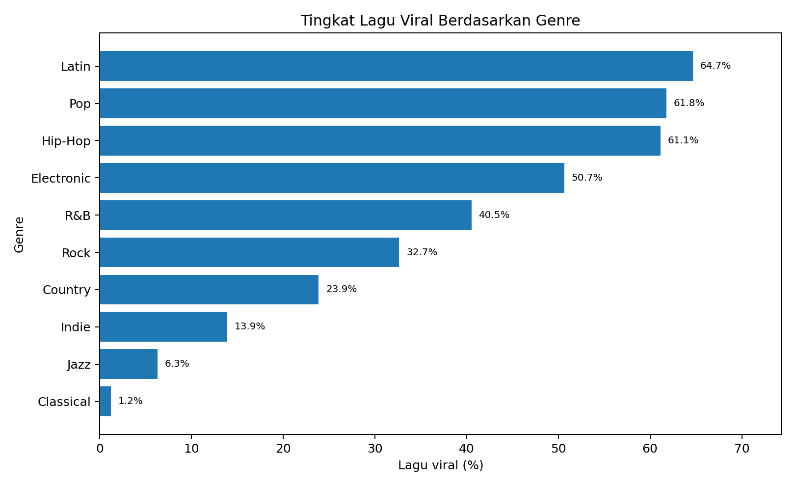
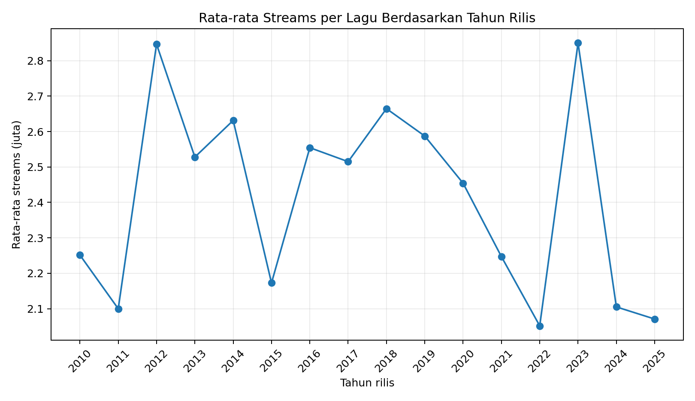
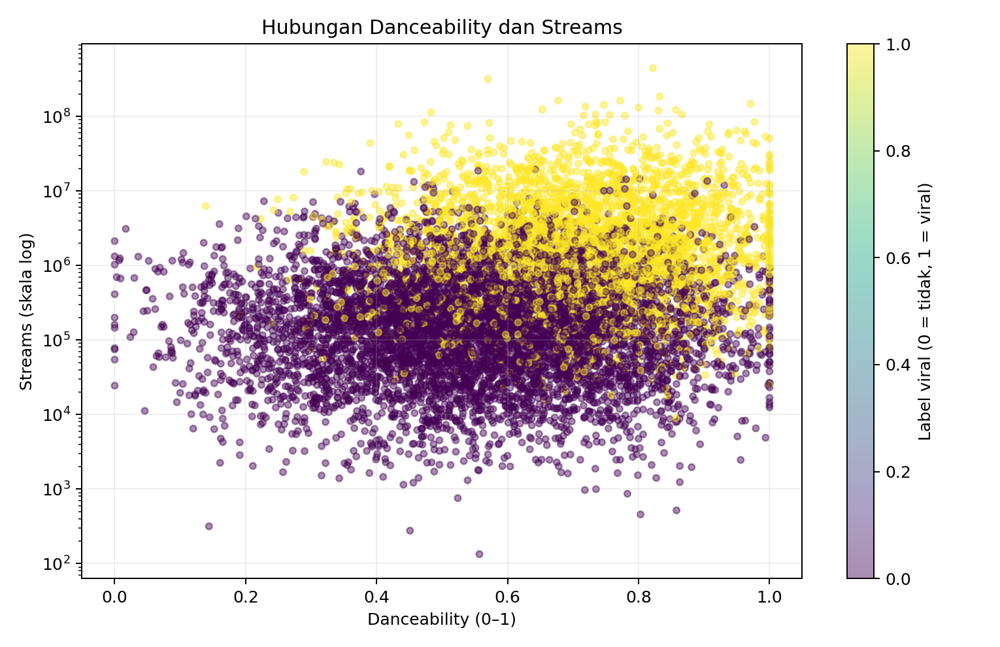
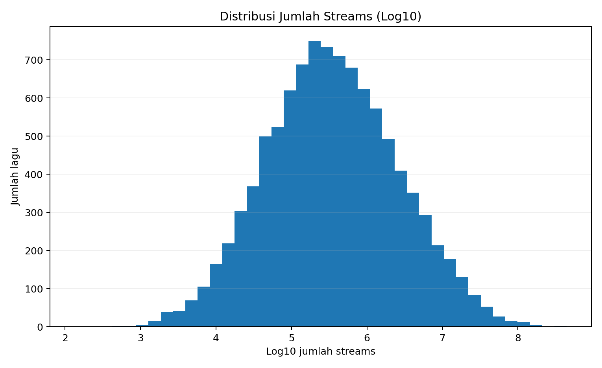
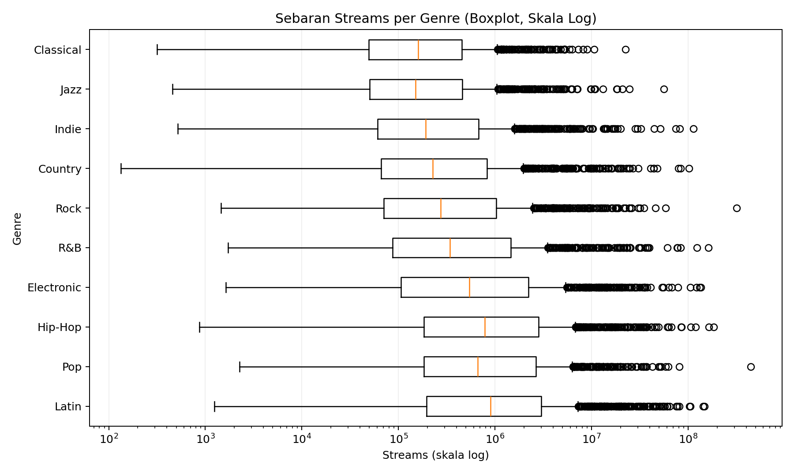
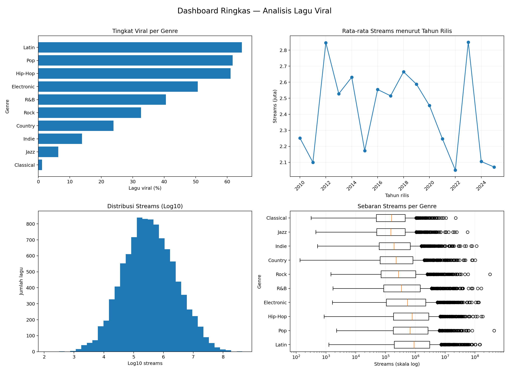

# Tugas Proyek Integrasi (Challenge)

## Judul Proyek
# What Makes a Song Go Viral?
### Analisis Genre, Karakteristik Audio, dan Performa Streaming Lagu Viral

**Tingkat Kesulitan:** Advanced  
**Model Pengerjaan:** Project Based Learning (studi kasus Data Analyst)  
**Pengerjaan:** Kelompok
**Anggota:** Ananda Putra Prawira, Janeeta Samahat Nowa, Sepvaldi Firmandah Ramadhan, Revantyo Hafiz Prasetyawan
**Dataset:** `viral_songs.csv` — *What Makes a Song Go Viral? — 10,000 Tracks with Audio Features*  
**Periode data:** 2010–2025  
**Jumlah data:** 10.000 lagu, 17 kolom

---

## 1. Skenario

Sebuah platform musik digital fiktif bernama **NusaSound** ingin memahami pola lagu yang berhasil menarik banyak pendengar. Tim pengelola melihat bahwa jumlah streaming setiap lagu berbeda jauh dan tidak semua genre memiliki peluang viral yang sama. Mereka membutuhkan analisis yang lebih terarah sebelum menyusun strategi kurasi playlist dan program promosi untuk periode berikutnya.

Sebagai Data Analyst, kami diminta memeriksa dataset yang berisi informasi genre, tahun rilis, karakteristik audio, jumlah streams, serta label `viral`. Analisis ini bertujuan mencari pola yang terlihat pada data: genre mana yang memiliki tingkat viral dan jumlah streams tertinggi, bagaimana karakteristik audio berhubungan dengan performa streaming, serta apakah terdapat lagu dengan jumlah streams yang jauh berbeda dari mayoritas.

Hasil akhirnya berupa ringkasan statistik, lima jenis visualisasi, pemeriksaan outlier, dashboard sederhana, dan rekomendasi yang dapat menjadi bahan diskusi bagi pengelola NusaSound.

**Pertanyaan utama proyek:**
1. Genre apa yang memiliki tingkat lagu viral dan total streams tertinggi?
2. Apakah performa streaming berbeda menurut tahun rilis?
3. Apakah fitur audio seperti `danceability` memiliki hubungan dengan jumlah streams?
4. Bagaimana sebaran streams dan adakah lagu yang berpotensi menjadi outlier?
5. Temuan apa yang dapat dijadikan dasar untuk menguji strategi kurasi playlist?

---

## 2. Dataset dan Pemahaman Data

Dataset yang digunakan adalah `viral_songs.csv` dari arsip dataset Kaggle yang dilampirkan. Berdasarkan README dan datasheet yang menyertai dataset, data ini merupakan **data sintetis**: setiap baris mewakili satu lagu buatan, fitur audionya dibentuk mengikuti distribusi per genre, label `viral` diturunkan dari skor berbobot fitur audio dan kecenderungan genre, sedangkan `streams` dibentuk mengikuti distribusi lognormal dengan pengali tambahan untuk lagu berlabel viral.

Dengan demikian, dataset ini cocok untuk latihan analisis, klasifikasi, regresi, dan visualisasi. Namun, hasilnya **tidak boleh dianggap sebagai gambaran aktual Spotify atau perilaku pendengar sungguhan**. Nama lagu dan artis juga merupakan identitas sintetis.

### Kolom yang digunakan

| Kelompok | Kolom | Keterangan |
|---|---|---|
| Identitas | `track_id`, `track_name`, `artist` | ID lagu, nama lagu, dan artis sintetis |
| Kategori/waktu | `genre`, `release_year` | Genre dan tahun rilis |
| Fitur audio | `duration_sec`, `danceability`, `energy`, `valence`, `tempo_bpm`, `acousticness`, `instrumentalness`, `speechiness`, `liveness`, `loudness_db` | Karakteristik audio lagu |
| Performa/target | `streams`, `viral` | Jumlah pemutaran dan label viral (1 = viral, 0 = tidak viral) |

### Pemeriksaan kualitas data

| Pemeriksaan | Hasil |
|---|---:|
| Jumlah baris | 10.000 |
| Jumlah kolom | 17 |
| Missing value | 0 |
| Baris duplikat identik | 0 |
| `track_id` duplikat | 0 |
| Jumlah genre | 10 |
| Rentang tahun rilis | 2010–2025 |
| Nilai unik pada `viral` | 0 dan 1 |

**Keputusan cleaning:** dataset sudah lengkap dan konsisten untuk analisis awal. Tidak ada baris yang perlu dihapus atau nilai kosong yang perlu diimputasi. Pemeriksaan tetap dilakukan terhadap duplikat, ID lagu, tipe data, rentang fitur audio, serta label `viral` agar kualitas data dapat dipastikan sebelum dianalisis.

---

## 3. Ringkasan Statistik

Berikut ringkasan statistik utama yang digunakan untuk memahami performa dataset.

| Indikator | Hasil |
|---|---:|
| Total lagu | 10.000 |
| Total streams seluruh lagu | 24.156.848.231 |
| Rata-rata streams per lagu (mean) | 2.415.685 |
| Median streams per lagu | 329.058 |
| Standar deviasi streams | 9.721.026 |
| Lagu berlabel viral (`viral = 1`) | 3.605 (36,05%) |
| Lagu tidak viral (`viral = 0`) | 6.395 (63,95%) |
| Rata-rata durasi lagu | 208.78 detik |
| Rata-rata danceability | 0.612 |
| Rata-rata energy | 0.652 |
| Rata-rata valence | 0.582 |

Mean streams jauh lebih tinggi daripada median. Ini menunjukkan distribusi streams memiliki ekor panjang ke arah nilai besar: sebagian kecil lagu memperoleh streams sangat tinggi dan menaikkan rata-rata. Karena itu, median dan kuartil juga perlu diperhatikan, bukan hanya mean.

### Ringkasan performa per genre

| Genre | Jumlah lagu | Total streams | Rata-rata streams/lagu | Tingkat viral |
|---|---:|---:|---:|---:|
| Latin | 1.030 | 4.579.608.240 | 4.446.222 | 64,66% |
| Pop | 1.002 | 3.401.236.717 | 3.394.448 | 61,78% |
| Hip-Hop | 1.052 | 4.173.261.741 | 3.966.979 | 61,12% |
| Electronic | 991 | 3.422.101.211 | 3.453.180 | 50,66% |
| R&B | 950 | 2.445.126.067 | 2.573.817 | 40,53% |
| Rock | 1.084 | 1.928.818.530 | 1.779.353 | 32,66% |
| Country | 942 | 1.698.067.053 | 1.802.619 | 23,89% |
| Indie | 993 | 1.342.315.787 | 1.351.778 | 13,90% |
| Jazz | 965 | 678.676.142 | 703.291 | 6,32% |
| Classical | 991 | 487.636.743 | 492.065 | 1,21% |

Dari tabel tersebut, **Latin** menempati posisi teratas untuk tingkat viral (64,66%) dan total streams (4.579.608.240). Pop dan Hip-Hop juga memiliki tingkat viral di atas 61%. Sebaliknya, Classical memiliki tingkat viral paling rendah (1,21%) dan total streams paling kecil di antara genre pada dataset ini.

### Perbandingan rata-rata streams menurut tahun rilis

| Tahun rilis | Jumlah lagu | Rata-rata streams/lagu |
|---:|---:|---:|
| 2010 | 600 | 2.251.421 |
| 2011 | 623 | 2.099.913 |
| 2012 | 635 | 2.846.577 |
| 2013 | 652 | 2.527.984 |
| 2014 | 669 | 2.631.379 |
| 2015 | 638 | 2.172.729 |
| 2016 | 582 | 2.554.485 |
| 2017 | 584 | 2.515.042 |
| 2018 | 610 | 2.664.693 |
| 2019 | 637 | 2.587.302 |
| 2020 | 624 | 2.454.193 |
| 2021 | 593 | 2.247.043 |
| 2022 | 688 | 2.051.574 |
| 2023 | 652 | 2.850.161 |
| 2024 | 604 | 2.105.046 |
| 2025 | 609 | 2.070.797 |

Rata-rata streams tertinggi terdapat pada lagu yang dirilis tahun **2023** (sekitar 2.850.161 per lagu). Rata-rata terendah terdapat pada kelompok rilis **2022** (sekitar 2.051.574 per lagu). Karena kolom yang tersedia adalah `release_year`, grafik ini membandingkan kelompok lagu berdasarkan tahun rilis, bukan merekam perubahan streams dari bulan ke bulan pada tahun tersebut.

---

## 4. Visualisasi dan Insight

### 4.1 Bar Chart — Tingkat Lagu Viral per Genre

**Insight:** Genre Latin memiliki tingkat viral tertinggi, yaitu **64,66%**, disusul Pop (61,78%) dan Hip-Hop (61,12%). Classical berada di posisi terendah dengan 1,21%, sehingga perbedaan tingkat viral antargenre terlihat cukup lebar pada dataset ini.

### 4.2 Line Chart — Rata-rata Streams Berdasarkan Tahun Rilis

**Insight:** Rata-rata streams per lagu tertinggi muncul pada kelompok rilis tahun **2023**, sekitar 2,85 juta, dan hampir sama dengan tahun 2012. Polanya naik-turun, bukan tren kenaikan yang stabil; karena itu, tahun rilis saja belum cukup untuk menjelaskan performa streaming suatu lagu.

### 4.3 Scatter Plot — Danceability dan Streams

**Insight:** Hubungan danceability dengan streams cenderung positif, tetapi lemah: korelasi Pearson sekitar **0,121** dan Spearman sekitar **0,244**. Rata-rata danceability lagu berlabel viral adalah 0,711, sedangkan lagu tidak viral 0,556; meskipun begitu, danceability tidak dapat dipakai sendirian untuk memperkirakan jumlah streams.

### 4.4 Histogram — Distribusi Jumlah Streams

**Insight:** Pada skala asli, distribusi streams sangat miring ke kanan karena ada sebagian kecil lagu dengan angka pemutaran yang jauh lebih tinggi daripada mayoritas. Histogram menggunakan transformasi log10 agar rentang nilai lebih mudah dibaca; median data tetap hanya **329.058 streams**, jauh di bawah mean sekitar 2,42 juta.

### 4.5 Boxplot — Sebaran Streams per Genre dan Outlier

**Insight:** Semua genre memperlihatkan titik di atas whisker boxplot, yang menandakan adanya lagu dengan streams jauh lebih tinggi daripada pola umum di genrenya. Titik tersebut tidak otomatis berarti kesalahan input; sebagian dapat merepresentasikan lagu yang sangat populer dalam simulasi dataset dan perlu ditinjau sebagai nilai ekstrem.

---

## 5. Deteksi Outlier dengan Metode IQR

Outlier diperiksa pada kolom `streams` dengan rumus:

- Q1 = **86.714,50**
- Q3 = **1.343.091,75**
- IQR = Q3 − Q1 = **1.256.377,25**
- Batas bawah = Q1 − 1,5 × IQR = **-1.797.851,38**
- Batas atas = Q3 + 1,5 × IQR = **3.227.657,62**

Karena jumlah streams tidak mungkin bernilai negatif, batas bawah yang negatif tidak menghasilkan outlier bawah. Dengan batas atas sekitar **3.227.657,62 streams**, ditemukan **1.399 lagu** yang berada di atas batas tersebut (sekitar 13,99% dari data).

Contoh nilai paling ekstrem adalah **track_06787** dari genre **Pop**, dengan **443.068.342 streams** dan label `viral = 1`. Nilai ini layak diperiksa lebih lanjut, tetapi tidak langsung dihapus karena dataset bersifat sintetis dan nilai ekstrem dapat memang menjadi bagian dari pola yang sengaja dibentuk.

### Jumlah titik di luar whisker pada boxplot per genre

| Genre | Titik outlier pada boxplot |
|---|---:|
| Country | 146 |
| Latin | 145 |
| Indie | 141 |
| Rock | 140 |
| Hip-Hop | 137 |
| Electronic | 133 |
| Jazz | 132 |
| R&B | 128 |
| Pop | 126 |
| Classical | 98 |

Catatan: jumlah pada tabel ini menggunakan batas IQR **masing-masing genre**, sesuai cara boxplot membentuk whisker per kelompok. Angka 1.399 di atas menggunakan satu batas IQR untuk seluruh dataset. Keduanya bisa berbeda karena dasar perhitungannya tidak sama.

---

## 6. Dashboard Ringkas

Dashboard berikut menggabungkan empat grafik dalam satu tampilan, sesuai ketentuan proyek: bar chart, line chart, histogram, dan boxplot.

**Insight dashboard:** Dalam satu tampilan terlihat bahwa Latin, Pop, dan Hip-Hop memiliki tingkat viral relatif tinggi, sementara rata-rata streams berdasarkan tahun rilis bergerak fluktuatif. Histogram dan boxplot memperlihatkan bahwa streams tidak tersebar merata dan memiliki banyak nilai ekstrem, sehingga keputusan sebaiknya mempertimbangkan median serta konteks genre, bukan hanya rata-rata.

---

## 7. Potensi Outlier dan Hal yang Perlu Diperhatikan

1. Terdapat 1.399 lagu di atas batas IQR global. Sebagian besar berada pada sisi atas distribusi, sesuai karakteristik streams yang memiliki ekor panjang.
2. Contoh paling ekstrem adalah `track_06787` dengan 443.068.342 streams. Nilai ini dipertahankan dalam analisis dan ditandai untuk pemeriksaan, bukan dianggap otomatis salah.
3. Metadata menjelaskan bahwa `viral` dibentuk dari skor berbobot fitur audio dan kecenderungan genre, sedangkan streams mendapat pengali untuk lagu viral. Karena itu, hubungan antara label viral dan streams sebagian memang sudah tertanam dalam proses pembuatan dataset.

---

## 8. Rekomendasi Bisnis

Untuk pengelola platform musik, hasil ini sebaiknya dipakai sebagai bahan uji strategi kurasi, bukan sebagai rumus pasti untuk menciptakan lagu viral. Dalam dataset, genre Latin memiliki tingkat viral tertinggi (64,66%) dan total streams terbesar (4,58 miliar). Pop dan Hip-Hop juga menunjukkan tingkat viral di atas 61%, sehingga ketiga genre tersebut layak mendapat ruang uji lebih besar pada playlist rekomendasi dan halaman eksplorasi. Electronic tetap menarik untuk dipantau karena tingkat viralnya sekitar 50,66% dan total streams-nya berada di kelompok atas.

Pengelola sebaiknya tidak hanya mengejar jumlah streams rata-rata. Selisih mean (2,42 juta) dan median (329 ribu) sangat lebar, yang berarti sebagian kecil lagu dengan streams sangat besar menaikkan rata-rata. Median, distribusi, dan pertumbuhan per kelompok tahun rilis perlu dilihat bersamaan agar keputusan tidak bertumpu pada beberapa lagu ekstrem. Fitur danceability dapat dijadikan salah satu variabel eksperimen karena rata-ratanya lebih tinggi pada lagu berlabel viral, tetapi korelasinya dengan streams masih lemah. Karena itu, jangan menjadikan danceability sebagai satu-satunya syarat pemilihan lagu.

Langkah berikutnya adalah menguji beberapa versi playlist secara terukur, mencatat perubahan jumlah pemutaran dan retensi pendengar, lalu membandingkan hasilnya. Lagu dengan streams sangat tinggi perlu ditinjau sebagai kandidat keberhasilan khusus, bukan langsung dianggap kesalahan. Terakhir, hasil ini harus divalidasi lagi menggunakan data streaming nyata sebelum diterapkan pada keputusan bisnis. Dataset yang dianalisis bersifat sintetis, sehingga pola di dalamnya berguna untuk latihan analisis, tetapi belum mewakili perilaku pendengar sebenarnya.

---

## 9. Kesimpulan

Dari 10.000 lagu yang dianalisis, genre Latin memiliki tingkat viral dan total streams tertinggi. Pop dan Hip-Hop juga memperlihatkan tingkat viral yang tinggi, sedangkan Classical berada pada tingkat terendah. Performa streams berdasarkan tahun rilis berfluktuasi dan tidak menunjukkan kenaikan yang konsisten.

Jumlah streams memiliki sebaran sangat lebar dan banyak nilai ekstrem. Hubungan danceability dengan streams bersifat positif tetapi lemah, sehingga fitur audio tersebut tidak cukup untuk menjadi satu-satunya dasar memilih lagu. Hasil ini dapat digunakan untuk latihan menyusun strategi kurasi dan menguji hipotesis, dengan catatan dataset bersifat sintetis dan perlu validasi menggunakan data streaming aktual sebelum dipakai untuk keputusan bisnis nyata.

---
